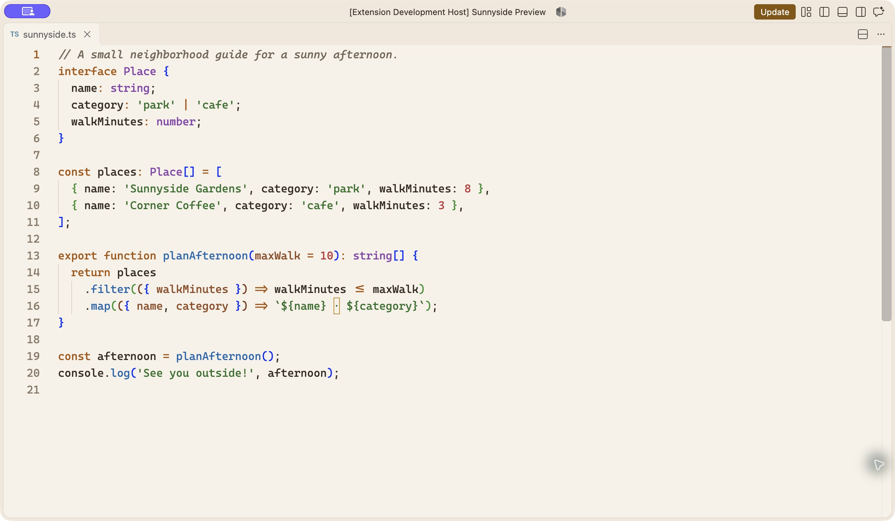
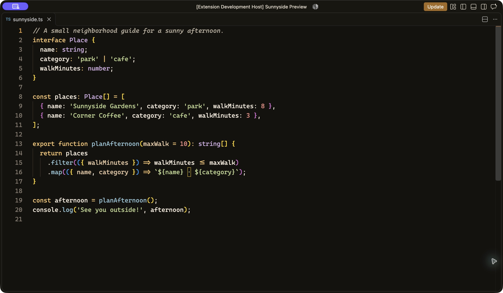

# Sunnyside for VS Code

Warm light and dark themes inspired by Sunnyside, Queens. Cream, amber, and charcoal anchor a colorful palette that gives code and Markdown a clear hierarchy.

## Features

- **Sunnyside Light:** warm paper with rich syntax accents.
- **Sunnyside Dark:** charcoal with bright, warm accents.
- Shared color roles for JavaScript, TypeScript, and Markdown.
- Six distinct Markdown heading colors, italic comments, and styled links and emphasis.
- Bold amber Markdown table headers and matching integrated terminal palettes.

## Preview

### Sunnyside Light



### Sunnyside Dark



See the [palette and design guide](docs/DESIGN.md) for color swatches, hex values, and syntax roles.

## Install

Install [Sunnyside from the Visual Studio Marketplace](https://marketplace.visualstudio.com/items?itemName=portenez.sunnyside-theme), or search for `@id:portenez.sunnyside-theme` in VS Code's Extensions view.

Run **Preferences: Color Theme** and choose **Sunnyside Light** or **Sunnyside Dark**.

VS Code 1.90 or later is required. Fonts are not bundled; choose any editor font you enjoy. Font ligatures are optional.

## Markdown highlighting

The extension highlights Markdown source; it does not style the rendered preview. A small semantic token provider identifies table headers locally. It makes no network calls and writes no files.

Tables inside blockquotes and multiline table headers are not supported. The extension targets desktop and remote VS Code; a web extension entry point is not included.

## Development and testing

Use the Node version in `.node-version` and npm:

```sh
fnm use
npm ci
npm test
npm run package
```

Open this repository in VS Code and press **F5** to launch the Extension Development Host. Select each theme and inspect `samples/MARKDOWN-SAMPLE.md`, JavaScript/TypeScript, and the integrated terminal. F5 tests the source; also install the packaged VSIX in an isolated testing instance before a release.

GitHub Actions runs tests and packages a downloadable VSIX for pull requests and pushes to `main`. See `PUBLISHING.md` in the source repository for the visual test checklist, authentication setup, and manual release workflow.

## License

Sunnyside uses the MIT License. See the bundled `LICENSE` for the full terms.
