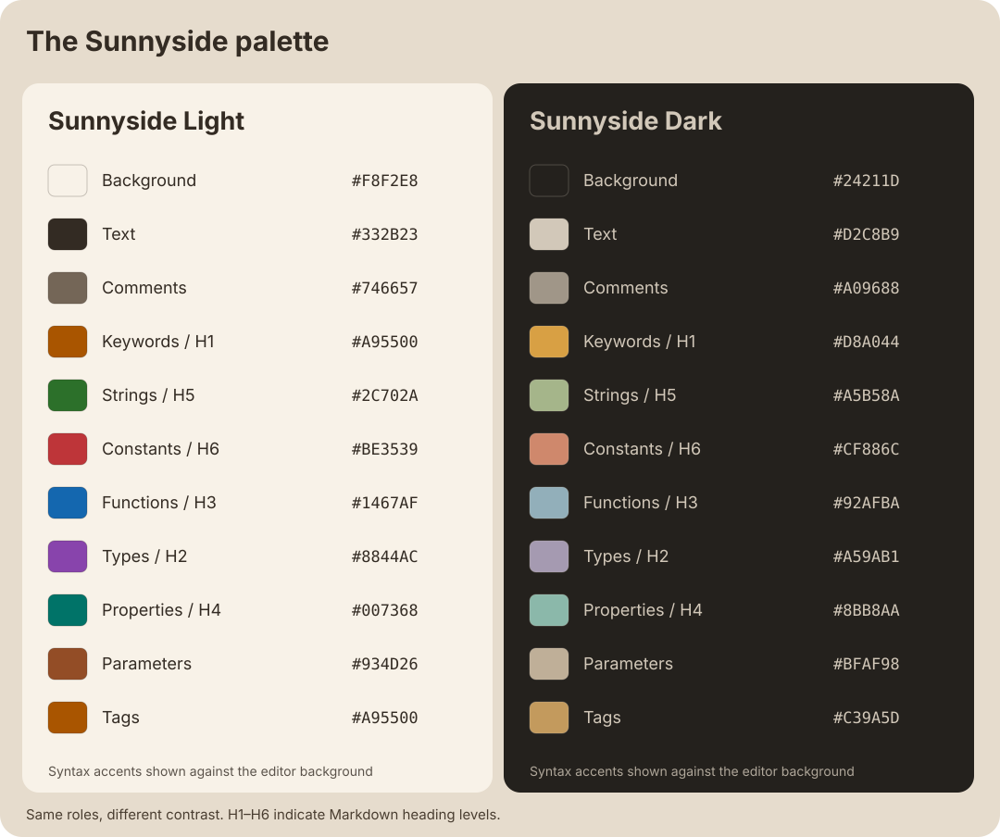

# Sunnyside design

Sunnyside pairs warm backgrounds with amber, green, blue, violet, coral, and teal accents. Light and Dark share syntax roles so switching between them keeps the code's visual hierarchy familiar.

## Palette

Each panel shows colors against its editor background. H1–H6 refer to Markdown heading levels. The tag color has its own row because Dark uses a different amber for tags and keywords.

Run `npm run palette` after changing either theme to regenerate this chart from the source files.

## Light and Dark

Sunnyside Light uses warm paper (`#F8F2E8`) and dark brown text (`#332B23`). Its deeper accents preserve contrast against the light background.

Sunnyside Dark uses warm charcoal (`#24211D`) with softened cream text (`#D2C8B9`) and muted accents. The lifted background and reduced foreground brightness aim to make long reading sessions more comfortable while preserving distinct syntax roles. Each variant defines its own editor, workbench, and integrated terminal colors.

Dark emphasizes honey-gold (`#D8A044`) for keywords and H1, and terracotta coral (`#CF886C`) for constants and H6. A quieter violet (`#A59AB1`) supports types and H2 so the warm accents lead the palette. The softened background and body text stay unchanged. Ghostty uses the same accents in its ANSI palette.

Keep syntax roles consistent across both themes while choosing foreground colors for each background. Review selections, search matches, diagnostics, and terminal output alongside ordinary source text. Contrast against the base editor background alone does not establish readability in every UI state.

## Markdown

Markdown source uses the same color vocabulary as JavaScript and TypeScript:

| Heading | Color role |
| --- | --- |
| H1 | Amber, shared with keywords |
| H2 | Violet, shared with types |
| H3 | Blue, shared with functions |
| H4 | Teal, shared with properties |
| H5 | Green, shared with strings |
| H6 | Coral, shared with constants |

Both hash headings and underline-style H1/H2 receive heading styles. Comments use italics; emphasis, links, inline code, list markers, and fence labels have dedicated styles. Fenced code retains its embedded language highlighting.

VS Code's bundled Markdown grammar does not distinguish table header rows. The extension supplies a Markdown semantic token provider that detects a header followed by a delimiter row. Both themes style `sunnysideTableHeader:markdown` in bold amber. These rules target the source editor, not the rendered Markdown preview.

## Maintenance

Neovim's standalone `neovim/colors/sunnyside.lua` is generated with `npm run neovim`. It selects Light or Dark from Neovim's `background` option and maps the shared roles to classic syntax, Tree-sitter, LSP, Markdown, diagnostics, diff, and editor UI groups. Regenerate it after palette changes and run the headless checks documented in `neovim/README.md`.

Ghostty themes in `ghostty/` are generated from these same terminal colors with `npm run ghostty`. They use the editor selection background and terminal text color for selections, and the terminal background for text under the cursor. Run `node scripts/ghostty.js --check` to check that the generated files match the source.

- Edit `sunnyside-light.json` and `sunnyside-dark.json` in this repository. Keep corresponding syntax roles aligned.
- Use the F5 launch configuration to review changes in an Extension Development Host.
- Review `samples/MARKDOWN-SAMPLE.md` and `samples/sunnyside.ts`, then check the integrated terminal in both themes.
- Run `npm test` and `npm run package` after changes that affect distribution. Test the packaged VSIX separately before release; see `PUBLISHING.md`.
- Fonts are user preferences and are not part of the extension.
