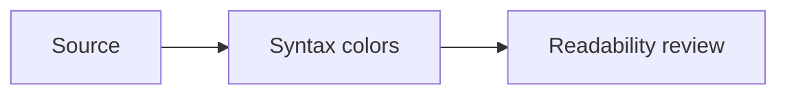

# Heading 1: Amber

Review this file as source and with **Open Preview to the Side** (Command-K, V). It covers CommonMark, common GitHub extensions, and optional syntax. Preview support varies; unsupported extensions may appear as plain text.

## Heading 2: Lavender

### Heading 3: Blue

#### Heading 4: Teal

##### Heading 5: Sage

###### Heading 6: Coral

Underline-style heading 1
=========================

Underline-style heading 2
-------------------------

## Paragraphs and emphasis

Ordinary text should remain comfortable to read. Compare **bold**, __alternate bold__, *italic*, _alternate italic_, ***bold italic***, and ~~strikethrough~~.

Inline code: `const count = 42`, `npm run build`, and ``code containing `backticks` ``.

Escaped punctuation: \*literal stars\*, \# not a heading, \[not a link\].

This line ends with a backslash for a hard break.\
This is the next line, inside the same paragraph.

## Links and images

[Inline link](https://example.com "Example title"), [reference link][example], and <https://example.com>.

Email autolink: <hello@example.com>. Local link: [design notes](../docs/DESIGN.md).


[example]: https://example.com "Reference title"

## Lists and tasks

- First unordered item with **emphasis**.
- Second item with `inline code`.
  - Nested item.
  - Another nested item.

1. First ordered item.
2. Second ordered item.
   1. Nested ordered item.
   2. Another nested item.

- [x] Headings have distinct colors.
- [x] JavaScript retains its palette.
- [ ] Check regular versus bold contrast.
- [ ] Review italic readability.

## Quotes and callouts

> A standard blockquote with *emphasis* and [a link](https://example.com).
>
> > A nested quote.

> [!NOTE]
> GitHub-style alerts are an extension; preview support depends on the renderer.

> [!TIP]
> Compare text at your normal font size.

> [!WARNING]
> A theme color can be attractive while still being hard to distinguish.

## Tables

| Element | Color role | Alignment |
| :--- | :---: | ---: |
| **Heading** | Amber | 1 |
| `inline code` | Sage | 2 |
| [Link](https://example.com) | Blue/teal | 3 |

## Dividers

---

***

___

## JavaScript fence

```javascript
// Comments should retain their italic styling.
const greeting = "Hello, Sunnyside";
const limit = 42;

export async function describe(items = []) {
  const visible = items.filter((item) => item.score >= limit);
  return visible.length !== 0 ? greeting : null;
}
```

## TypeScript / React fence

```tsx
import { useState } from "react";

type CardProps = {
  title: string;
  enabled?: boolean;
};

export function Card({ title, enabled = true }: CardProps) {
  const [count, setCount] = useState<number>(0);
  return (
    <button disabled={!enabled} onClick={() => setCount(count + 1)}>
      {title}: {count}
    </button>
  );
}
```

## Other fenced languages

```python
from dataclasses import dataclass

@dataclass
class Trip:
    destination: str
    days: int = 3

print(Trip("Queens"))
```

```bash
# Display a value without modifying your system.
project="sunnyside"
printf '%s\n' "$project"
```

```json
{
  "theme": "Sunnyside Dark",
  "ligatures": true,
  "fontSize": 13,
  "fallback": null
}
```

```css
.card {
  color: #f3eadb;
  background: #14120f;
  border: 1px solid #e8a23a;
}
```

```html
<article class="card">
  <h2>Sunnyside</h2>
  <p>A warm palette for everyday work.</p>
</article>
```

```diff
- const theme = "Kai Light";
+ const theme = "Sunnyside Dark";
```

~~~text
Tilde fence: plain text with no language highlighting.
~~~

````markdown
A nested fence example:

```js
const nested = true;
```
````

    Indented code block.
    No language label is available here.

## Raw HTML and comments

<!-- This comment should be visible only in the source. -->

<details>
<summary>Expandable details</summary>

**Markdown inside HTML**, separated by blank lines.

</details>

Text with <kbd>Command</kbd> + <kbd>K</kbd>, <sup>superscript</sup>, <sub>subscript</sub>, and <mark>highlighting</mark>. HTML rendering and sanitization vary.

## Optional extensions

These examples test source highlighting; rendering is not guaranteed in every preview.

Footnote reference[^review].

[^review]: A sample footnote with **bold text**.

Inline math: $E = mc^2$.

$$
\sum_{i=1}^{n} i = \frac{n(n+1)}{2}
$$



Definition term
: A definition-list example, supported by some Markdown renderers.

## Review checklist

- [ ] All six heading levels are distinct.
- [ ] Bold, italic, and bold italic remain distinguishable.
- [ ] Links stand out without dominating paragraphs.
- [ ] Lists, tables, and code fences are easy to scan.
- [ ] Embedded JavaScript and TypeScript look like standalone code.
- [ ] Source and preview are both readable.
